# Ghost in the GPU
> *"Clone your visual sensory mind into a neural core, so a part of you stays alive in CUDA memory forever."*

<div align="left">

|  |  | |
| :---: | :---: | :---: |

</div>

---

## The Philosophy

Every human perceives the world through a distinct, unrepeatable aesthetic lens. You can glance at an image for 100 milliseconds and immediately feel whether it resonates with you—yet translating that intuition into words or rules is nearly impossible.

**Ghost in the GPU** is a **Multi-Domain Active-Learning Sensory Engine**. Create dedicated domains for every side of your visual taste—*Wallpapers*, *Portraits & Art*, *Photography*, *Architecture*, *Cars*, or *Cinema Frames*.

For each domain, the engine presents rapid head-to-head visual comparisons to map your exact multi-dimensional affinity boundary, forging a lightweight **Ghost Mind** (`domain_<id>_brain.pkl`):
- Weighs less than **100 KB**.
- Portable: swap `.pkl` files with friends to experience reality through their visual perception.
- Permanent: watch your digital ghost sort thousands of unseen images at 90+ images/second in the 60–120 FPS **Flex Sorter**.

---

## Key Features

1. **Multi-Domain Sensory Hub (`/`)**:
   - Create unlimited isolated visual domains (e.g., *Wallpapers*, *Portraits*, *Photography*).
   - Each domain maintains its own image library, pairwise comparisons, and trained neural brain.
2. **Dedicated Domain Workspace (`/domain?id=1`)**:
   - **Paginated Gallery & Batch Filtering**: Browse your domain's images with customizable page sizes (24 / 48 / 96 per page), filter by import batch tag, sort by Ghost Score or date, and toggle **👁️ PE-Core View** (24×24 ViT patch grid preview).
   - **Built-in Canvas Image Editor & HQ Replacer**: Crop (Free, 1:1, 3:4, 4:3 with 3×3 rule-of-thirds grid), apply resolution-scaled brush or rectangle blur masks, or replace an image with a higher-resolution file/URL—automatically re-embedding in 1024D space while preserving its entire rating history.
   - **Smart Selection & Bulk Management**: One-click **"Select All on Page"**, move selected images across domains, or bulk-delete cleanly.
   - **Built-in Importer & Batch Rollback (`/import`)**: Upload local files (JPG, PNG, WebP, AVIF, HEIC) or paste remote image URLs with custom batch tags and one-click batch rollback.
   - **1-Click Neural Training**: Click **"Train This Ghost"** right inside the workspace—spawns a live Rich terminal tournament leaderboard!
3. **4-Mode Active Learner & 🪞 Mirror Mode (`/rate`)**:
   - **4 Sampling Strategies**: Switch between *Active Exploration*, *👑 Elite Boss Battles*, *🎯 Top Bracket* (unfought top-16 showdowns), and *🧬 Contrastive Twins* (high-similarity lookalikes with divergent scores).
   - **🪞 Mirror Mode (Test-Retest Reliability)**: Injects historical comparisons ($\ge 48\text{h}$ old) at a 20% rate to measure your personal rating consistency with a **Wilson 95% confidence interval**, isolating retests from training while downweighting noisy pairs.
4. **Data Hygiene Suite (`/duplicates`, `/audit`, `/history`)**:
   - **🧹 Duplicate Cleaner (`/duplicates`)**: Scans 1024D cosine similarity ($\ge 92\%\text{–}99\%$) to detect near-duplicates or re-encoded files and performs non-contradictory merges that transfer battle history to the higher-resolution keeper.
   - **🔍 Misclick Audit Tool (`/audit`)**: Flags past comparisons where your clicked winner strongly contradicts your trained Ghost brain ($\Delta s \ge \text{threshold}$), allowing one-click winner flips or deletion.
   - **📜 Comparison History (`/history`)**: Filter comparisons by Image ID and bulk-delete comparison records with automatic cleanup of dependent retests.
5. **60–120 FPS Neo-Brutalist Flex Sorter (`/flex`)**:
   - Watch your trained Ghost blitz through your domain library in single or dual-stack turbo mode with zero layout lag and adjustable percentile thresholds (Top 50%, 70%+, 80%+, 90%+ Elite).
   - Switch between domains on the fly from the header dropdown.
6. **Multi-Domain Browser Extension (`extension/`)**:
   - Hover over any web image or video and click **Test** (instant in-memory score & percentile tier badge without saving to disk/DB) or click **Log** / press **`Alt + L`** to ingest full-resolution original bytes directly into your active domain.
   - Select your **Active Domain** directly from the extension popup dropdown.

---

## Quickstart (2 Minutes)

### 1. Clone & Launch
```bash
git clone https://github.com/rachit9876/ghost-in-the-gpu.git
cd ghost-in-the-gpu
```

- **Windows**: Double-click **`START.bat`**
- **Linux / macOS**: Run `./start.sh`

*The launcher automatically creates `.venv`, installs `requirements.txt`, downloads the `PE-Core-L14-336` vision backbone on first use, and opens [`http://127.0.0.1:8770/`](http://127.0.0.1:8770/).*

### 2. Install the Browser Extension (Optional)
1. Open Chrome / Brave / Edge and go to `chrome://extensions`.
2. Enable **Developer mode** (top right).
3. Click **Load unpacked** and select the `ghost-in-the-gpu/extension` folder.
4. Click the extension icon in your toolbar to choose which **Domain** to log and score images into!

---

## Architecture & System Design

```mermaid
flowchart LR
    subgraph L1["1 · Perception & Ingestion"]
        direction TB
        A["Image Inputs<br/>Local · URL · Extension"]
        B["SHA-256 Dedupe &<br/>EXIF / Bomb Guard"]
        C["Aspect-Aware<br/>1:1 Multi-Crop"]
        D["PE-Core-L14-336<br/>1024D Vector (.npy)"]
        A --> B --> C --> D
    end

    subgraph L2["2 · Active Learning & Mirror"]
        direction TB
        E{"Sampling Engine<br/>/api/next"}
        F["Active · 👑 Elite<br/>🎯 Top Bracket"]
        G["🧬 Contrastive<br/>τ ∈ [0.76, 0.85] & max|Δs|"]
        H["🪞 Mirror Retest<br/>20% Rate (≥ 48h)"]
        I["Human Choice<br/>A vs B vs C"]
        J[("SQLite taste.db<br/>WAL Mode")]
        E --> F --> I
        E --> G --> I
        E --> H --> I
        I --> J
    end

    subgraph L3["3 · Neural Tournament"]
        direction TB
        K["Weighted Pair Diffs<br/>Δx = X_win − X_loss"]
        L["Per-Fold PCA<br/>d ∈ [32, 1024]"]
        M["5-Fold CV<br/>LogReg L2 · LinearSVM · L1"]
        N["Champion Ghost Mind<br/>domain_X_brain.pkl<br/>&lt; 100 KB"]
        K --> L --> M --> N
    end

    subgraph L4["4 · Inference & Hygiene"]
        direction TB
        O["GhostScorer<br/>Atomic Reload"]
        P["score = (PCA(v)·w) + b"]
        Q["60–120 FPS<br/>Flex Sorter (/flex)"]
        R["Extension Test/Log &<br/>Audit · Duplicates"]
        O --> P
        P --> Q
        P --> R
    end

    D --> E
    J --> K
    N --> O
```



### 1. Perception & Ingestion Layer (`ghost.sensory.backbone`, `ghost.sensory.ingest`)
- **Vision Foundation:** Uses Meta's `PE-Core-L14-336` vision transformer to map raw visual pixels into a dense, normalized **1024-dimensional semantic perception space**.
- **Aspect-Aware 1:1 Multi-Crop:** Instead of squashing wide or tall images into a distorted square, Ghost extracts strictly 1:1 square crops—3 multi-scale center crops (100%, 85%, 70%) for near-square images, or adaptive sliding-window crops along the longer axis for ultrawide/portrait images—and L2-normalizes their mean embedding.
- **Per-Domain Deduplication & Safety:** Images are validated against decompression bombs (capped at 80 MP), EXIF-transposed, and hashed via SHA-256. If another domain has already embedded the same file, the 1024D vector is reused without redundant GPU inference.
- **Thread-Safe Cold Start:** Model loading is guarded by thread locks and background pre-warming, ensuring concurrent requests never duplicate VRAM allocation.

### 2. Multi-Strategy Active Learning & Mirror Mode (`ghost.rater.server`, `ghost.rater.scorer`)
The engine actively searches for the exact hyperplanes of your personal aesthetic boundaries across 4 sampling modes plus test-retest verification:
- **Active Exploration:** Balances visual coverage across unexplored areas while querying uncertainty zones ($|s| \approx 0$).
- **👑 Elite Boss Battles:** Pits top-scoring images against each other to calibrate upper-percentile taste rankings.
- **🎯 Top Bracket:** Specifically schedules unfought head-to-head combinations among the top 16 highest-scoring images in the domain.
- **🧬 Contrastive Twins:** Computes the 1024D pairwise cosine similarity matrix with an adaptive 98th-percentile threshold clamped to $\tau \in [0.76, 0.85]$. It samples lookalike pairs that share high visual similarity ($\ge \tau$) while maximizing aesthetic score divergence ($|\Delta s|$), rapidly pinning down subtle stylistic distinctions.
- **🪞 Mirror Mode (Test-Retest Reliability):** Optionally injects historical comparisons ($\ge 48\text{h}$ old) at a 20% rate, tracks human consistency with a **Wilson 95% confidence interval**, and automatically downweights noisy pairs during training.

### 3. Ghost Neural Tournament (`ghost.sensory.tournament`)
- **Consistency-Weighted Pair Differences:** Pairwise comparisons $(A \succ B)$ are modeled as symmetric difference vectors ($\Delta x = x_A - x_B \implies y = 1$, $-\Delta x \implies y = 0$) weighted by test-retest reliability:
  $$w_{\text{pair}} = \max(0.20,\; 1.0 - 0.8 \times \text{flip\_rate})$$
- **Zero-Leakage Per-Fold PCA:** Evaluates candidate latent dimensions $d \in \{32, 48, 64, 96, 128, 192, 256, 384, 512, 768, 896, 1024\}$, fitting PCA strictly on each fold's training split to prevent data leakage.
- **5-Fold Cross-Validation Grid:** Benchmarks **9 linear contenders** per dimension—*Logistic Regression (L2, $C \in \{0.1, 0.5, 1.0, 2.0\}$)*, *Linear SVM ($C \in \{0.1, 0.5, 1.0\}$)*, and *Sparse L1 Logistic Regression ($C \in \{0.5, 1.0\}$)*. The `(dimension, algorithm)` contender with the highest 5-fold CV accuracy is crowned champion.
- **Atomic Serialization:** PCA and brain weights are written to `.tmp` files and swapped atomically via `os.replace()`, preventing web workers from reading half-written models.

### 4. Zero-Lag Inference & Flex Engine (`ghost.rater.scorer`, `/flex`)
- **Instant Projection:** Scoring an unseen image requires only a single PCA transform and dot-product:
  $$\text{score} = \langle \mathbf{w}, \text{PCA}(\mathbf{v}) \rangle + b$$
- **Ultra-Lightweight Footprint:** The complete Ghost Mind weighs **< 100 KB** and scores images in sub-millisecond speeds, powering 90+ images/second throughput in the neo-brutalist Flex Sorter.

---

## Requirements
- Python 3.10+
- NVIDIA GPU with CUDA recommended (CPU supported automatically)
- See `requirements.txt` for pinned packages.

---

## License
MIT License. Built for the digital preservation of human visual intuition.
