# Ghost in the GPU
> *"Clone your visual sensory mind into a neural core, so a part of you stays alive in CUDA memory forever."*

<div align="left">

|  |  | |
| :---: | :---: | :---: |

</div>

---

## The Philosophy

Every human perceives the world through a distinct, unrepeatable aesthetic lens. You can glance at an image for 100 milliseconds and immediately feel whether it resonates with you—yet translating that intuition into words or rules is nearly impossible.

**Ghost in the GPU** is a **Multi-Domain Active-Learning Sensory Engine**. Create dedicated domains for every side of your visual taste—*Wallpapers*, *Portraits & Art*, *Photography*, *Architecture*, *Cars*, or *Cinema Frames*.

For each domain, the engine presents rapid head-to-head visual comparisons to map your exact multi-dimensional affinity boundary, forging a lightweight **Ghost Mind** (`domain_<id>_brain.pkl`):
- Weighs less than **100 KB**.
- Portable: swap `.pkl` files with friends to experience reality through their visual perception.
- Permanent: watch your digital ghost sort thousands of unseen images at 90+ images/second in the 60–120 FPS **Flex Sorter**.

---

## Key Features

1. **Multi-Domain Sensory Hub (`/`)**:
   - Create unlimited isolated visual domains (e.g., *Wallpapers*, *Portraits*, *Photography*).
   - Each domain maintains its own image library, pairwise comparisons, and trained neural brain.
2. **Dedicated Domain Workspace (`/domain?id=1`)**:
   - **Paginated Gallery**: Browse your domain's images with customizable page sizes (24 / 48 / 96 per page) and sort by Ghost Score or date.
   - **Smart Selection**: One-click **"Select All on Page"** or toggle individual cards.
   - **Bulk Management**: Move selected images to another domain or delete them cleanly in one click.
   - **Built-in Importer**: Upload local image files directly from your computer or paste image URLs.
   - **1-Click Neural Training**: Click **"Train This Ghost"** right inside the workspace—no terminal commands required!
3. **60–120 FPS Neo-Brutalist Flex Sorter (`/flex`)**:
   - Watch your trained Ghost blitz through your domain library at 90+ images/sec with zero layout lag.
   - Switch between domains on the fly from the header dropdown.
4. **Multi-Domain Browser Extension (`extension/`)**:
   - Hover over any image on the web and press **`Alt + L`** (or click **Log**).
   - Select your **Active Domain** directly from the extension popup dropdown—logged images are automatically embedded in 1024D PE-Core space and scored against that domain's brain in real time.

---

## Quickstart (2 Minutes)

### 1. Clone & Launch
```bash
git clone https://github.com/rachit9876/ghost-in-the-gpu.git
cd ghost-in-the-gpu
```

- **Windows**: Double-click **`START.bat`**
- **Linux / macOS**: Run `./start.sh`

*The launcher automatically creates `.venv`, installs `requirements.txt`, downloads the `PE-Core-L14-336` vision backbone on first use, and opens [`http://127.0.0.1:8770/`](http://127.0.0.1:8770/).*

### 2. Install the Browser Extension (Optional)
1. Open Chrome / Brave / Edge and go to `chrome://extensions`.
2. Enable **Developer mode** (top right).
3. Click **Load unpacked** and select the `ghost-in-the-gpu/extension` folder.
4. Click the extension icon in your toolbar to choose which **Domain** to log and score images into!

---

## Architecture & System Design

```mermaid
flowchart LR
    subgraph L1["1 · Perception & Ingestion"]
        direction TB
        A["Image Inputs<br/>Local · URL · Extension"]
        B["SHA-256<br/>Dedupe & Validate"]
        C["PE-Core-L14-336<br/>Backbone (CUDA/CPU)"]
        D["1024D Latent<br/>Vector (.npy)"]
        A --> B --> C --> D
    end

    subgraph L2["2 · Active Learning & Sampling"]
        direction TB
        E{"Sampling Engine<br/>/api/next"}
        F["Active<br/>Coverage + Uncertainty"]
        G["👑 Elite<br/>Boss Battles"]
        H["🧬 Contrastive<br/>CosSim ≥ 0.81 & max|Δs|"]
        I["Human Choice<br/>A vs B vs C"]
        J[("SQLite taste.db<br/>WAL Mode")]
        E --> F --> I
        E --> G --> I
        E --> H --> I
        I --> J
    end

    subgraph L3["3 · Neural Tournament"]
        direction TB
        K["Pairwise Preference<br/>Δx = X_win − X_loss"]
        L["Zero-Leakage<br/>Vectorized PCA"]
        M["5-Fold CV<br/>Ridge · LogReg · SGD · SVM"]
        N["Champion Ghost Mind<br/>domain_X_brain.pkl<br/>&lt; 100 KB"]
        K --> L --> M --> N
    end

    subgraph L4["4 · Inference & Flex Sorter"]
        direction TB
        O["GhostScorer<br/>Atomic Reload"]
        P["score = (PCA(v)·w) + b"]
        Q["60–120 FPS<br/>Flex Sorter (/flex)"]
        R["Browser Extension<br/>Alt+L Scoring"]
        O --> P
        P --> Q
        P --> R
    end

    D --> E
    J --> K
    N --> O
```



### 1. Perception & Ingestion Layer (`ghost.sensory.backbone`, `ghost.sensory.ingest`)
- **Vision Foundation:** Uses Meta's `PE-Core-L14-336` vision transformer to map raw visual pixels into a dense, normalized **1024-dimensional semantic perception space**.
- **Per-Domain Deduplication:** Images are hashed via SHA-256. If another domain has already embedded the same file, the 1024D vector is reused without redundant GPU inference.
- **Thread-Safe Cold Start:** Model loading is guarded by thread locks, ensuring concurrent browser extension requests don't duplicate VRAM allocation.

### 2. Multi-Strategy Active Learning (`ghost.rater.server`, `ghost.rater.scorer`)
The engine doesn't rely on random pairwise polling—it actively searches for the exact hyperplanes of your personal aesthetic boundaries:
- **Active Exploration:** Balances visual coverage across unexplored areas while querying uncertainty zones ($|s| \approx 0$).
- **👑 Elite Boss Battles:** Pits top-scoring images against each other to calibrate upper-percentile taste rankings.
- **🧬 Contrastive Twins:** Calculates the full 1024D pairwise cosine similarity matrix with an empirical similarity threshold ($\tau \ge 0.81$). It samples lookalike images that share extreme visual similarity but produce high aesthetic divergence ($|\Delta s|$), rapidly pinning down subtle stylistic distinctions.
- **Race-Free Human Feedback:** Sequential prefetching and debounced rating handlers ensure microsecond response times with zero repeated pairs.

### 3. Ghost Neural Tournament (`ghost.sensory.tournament`)
- **Pair Difference Formulation:** Pairwise comparisons $(A \succ B)$ are modeled as difference vectors:
  $$\Delta x = x_A - x_B \implies y = +1$$
- **Vectorized Dimension Reduction:** Automatically projects the sparse 1024D space down to an optimal compact latent dimension ($d \in [64, 512]$) using fit-once PCA.
- **Zero-Leakage 5-Fold Cross Validation:** Evaluates competing linear boundary classifiers (*Ridge Classifier*, *Logistic Regression*, *SGD Classifier*, and *Linear SVM*). The model achieving the highest CV accuracy is crowned champion.
- **Atomic Serialization:** Brains are written to `.tmp` files and swapped atomically using `os.replace()`, preventing web workers from reading half-written models.

### 4. Zero-Lag Inference & Flex Engine (`ghost.rater.scorer`, `/flex`)
- **Instant Projection:** Scoring an unseen image requires only a single PCA transform and dot-product:
  $$\text{score} = \langle \mathbf{w}, \text{PCA}(\mathbf{v}) \rangle + b$$
- **Ultra-Lightweight Footprint:** The complete Ghost Mind weighs **< 100 KB** and scores images in sub-millisecond speeds, powering 90+ images/second throughput in the neo-brutalist Flex Sorter.

---

## Requirements
- Python 3.10+
- NVIDIA GPU with CUDA recommended (CPU supported automatically)
- See `requirements.txt` for pinned packages.

---

## License
MIT License. Built for the digital preservation of human visual intuition.
